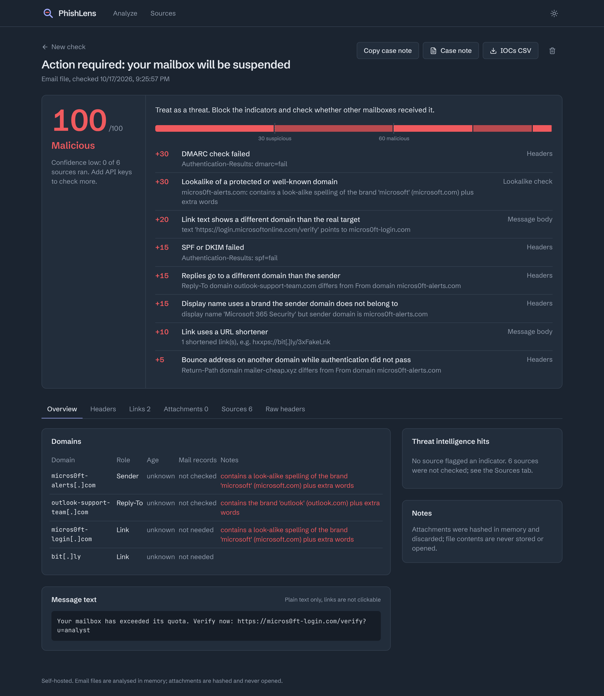

# PhishLens

**Self-hosted phishing triage for SOC analysts.** Paste a sender address, domain, URL, IP or hash, or drop the `.eml` a user reported. PhishLens queries every source at once and returns one verdict, and it shows exactly which evidence produced each point of the score.



Triage of a reported email usually means 8 to 12 browser tabs: VirusTotal, urlscan, MXToolbox, AbuseIPDB, WHOIS, header analyzers. Then the result gets copied into a ticket by hand. PhishLens does that fan-out in one request and writes the case note for you.

## What it checks

| Area | Checks |
| --- | --- |
| Headers | SPF, DKIM and DMARC results, Received chain with per-hop delays and origin IP, From vs Reply-To vs Return-Path, display-name spoofing |
| Sender domain | MX, SPF and DMARC records, registration age (RDAP), free-mail and disposable lists, lookalikes of well-known or your own domains |
| Links | Extracted from `href`, never from visible text; deceptive anchor text, shorteners, optional redirect resolution |
| Attachments | SHA-256 lookups, real type vs extension, double extensions, macro documents, encrypted archives, forms hidden in HTML attachments |
| Content | Payment-change and urgency wording typical of business email compromise |
| Threat intel | VirusTotal, AbuseIPDB, urlscan.io (search only), URLhaus, ThreatFox, MalwareBazaar, Have I Been Pwned |

Every source is optional. A missing key shows as **Not checked** in the report and lowers the confidence, never the score.

## Quick start

```bash
git clone https://github.com/<you>/phishlens.git && cd phishlens
cp .env.example .env        # add whichever API keys you have
docker compose up -d --build
```

Open http://localhost:8080 and try one of the fictitious emails in [`samples/`](samples/).

Free keys worth getting first: [abuse.ch](https://auth.abuse.ch/) (one key covers three sources), [AbuseIPDB](https://www.abuseipdb.com/register) and [urlscan.io](https://urlscan.io/user/signup). VirusTotal's free public key is for personal and non-commercial use; at work, use your organisation's premium key.

## How the verdict works

The score starts at 0, and only evidence moves it. Each triggered signal adds its weight, trust credits subtract, and the total is capped at 100.

| Score | Verdict |
| --- | --- |
| 0 to 29 | Likely legitimate |
| 30 to 59 | Suspicious, needs analyst review |
| 60 to 100 | Malicious |

- A confirmed malicious URL, hash or IOC (URLhaus, ThreatFox, MalwareBazaar, or VirusTotal with 3+ engines) is a **hard override**: the verdict is Malicious whatever the credits.
- Weights live in [`backend/app/scoring/weights.yaml`](backend/app/scoring/weights.yaml). Tune them against your own labelled cases.
- Confidence reflects how many sources actually ran.

## Safe by design

- **Nothing in the email runs.** HTML is tokenised for links, never rendered. Attachments are hashed in memory and discarded.
- **Indicators are defanged** everywhere: in the UI, the case note and the IOC export.
- **Attacker infrastructure is not contacted** by default. Short-link resolution is opt-in, uses HEAD requests only, and every hop is SSRF-checked against private address ranges.
- **urlscan is searched, never submitted to**, because a submission publishes the URL.
- **Privacy mode** (`PRIVACY_MODE=true`) stops full email addresses from leaving the server.
- **Retention:** reports are purged after `RETENTION_DAYS` (default 30).
- **Quota protection:** results are cached per indicator for 24 h, and VirusTotal lookups are capped per analysis and spent on the highest-priority indicators first.
- API keys stay server-side and are never returned to the browser. Containers run as non-root, the API filesystem is read-only, and nginx sends a strict CSP.

See [SECURITY.md](SECURITY.md) for the threat model and how to report a vulnerability.

## Architecture

```
Browser (React + TypeScript)
   │  /api  (REST + JSON)
   ▼
nginx ──► FastAPI: parse ─► extract IOCs ─► enrich in parallel ─► score ─► store
                                             │                       │
                                   Redis cache (per indicator)   SQLite / Postgres
                                             │
                    VirusTotal · AbuseIPDB · urlscan · abuse.ch · HIBP · DNS · RDAP
```

Each intelligence source is a plugin with one async `lookup()` method. See [docs/adding-a-source.md](docs/adding-a-source.md).

## API

Interactive docs are served at `/docs` on the API container (port 8000). These are the main endpoints:

| Method | Path | Purpose |
| --- | --- | --- |
| POST | `/api/analyze/indicator` | `{"value": "user@example.com"}`; accepts defanged input |
| POST | `/api/analyze/eml` | multipart upload of an `.eml` file |
| GET | `/api/reports/{id}` | full report JSON |
| GET | `/api/reports/{id}/case-note.md` | Markdown case note for your ticket |
| GET | `/api/reports/{id}/iocs.csv` | defanged IOC list |
| GET | `/api/settings/sources` | which sources are configured (no secrets) |

## Development

```bash
# backend
cd backend && python -m venv .venv && . .venv/bin/activate
pip install -r requirements-dev.txt
pytest                 # 56 tests, no network needed
uvicorn app.main:app --reload

# frontend (proxies /api to localhost:8000)
cd frontend && npm install && npm run dev
```

## Roadmap

- **v0.1 (this release):** sender and .eml analysis, five intel sources plus local checks, explainable score, case-note export, Docker.
- **v0.2:** searchable history, OTX, Safe Browsing and Spamhaus, PDF case note, `.msg` support, login (local accounts or OIDC).
- **v1.0:** Sentinel, Defender and QRadar lookups for the same sender across the tenant, opt-in sandbox submission, STIX/MISP export.

## Licence

MIT. See [LICENSE](LICENSE). Source data belongs to each provider and is subject to their terms.
